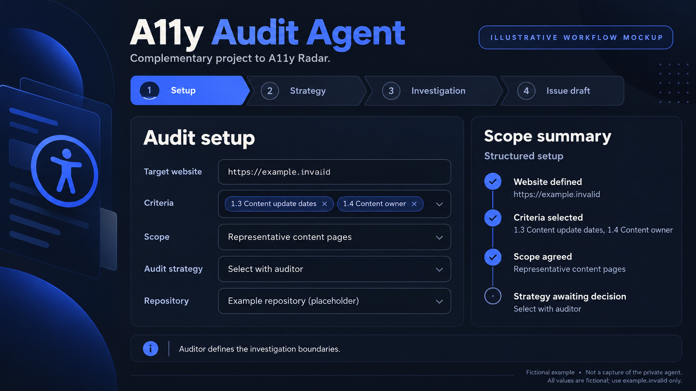
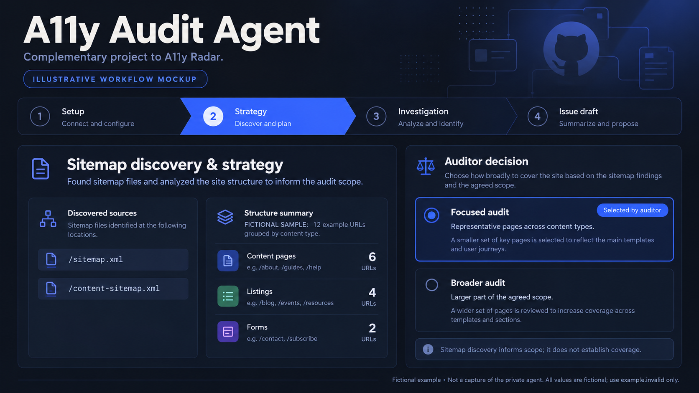
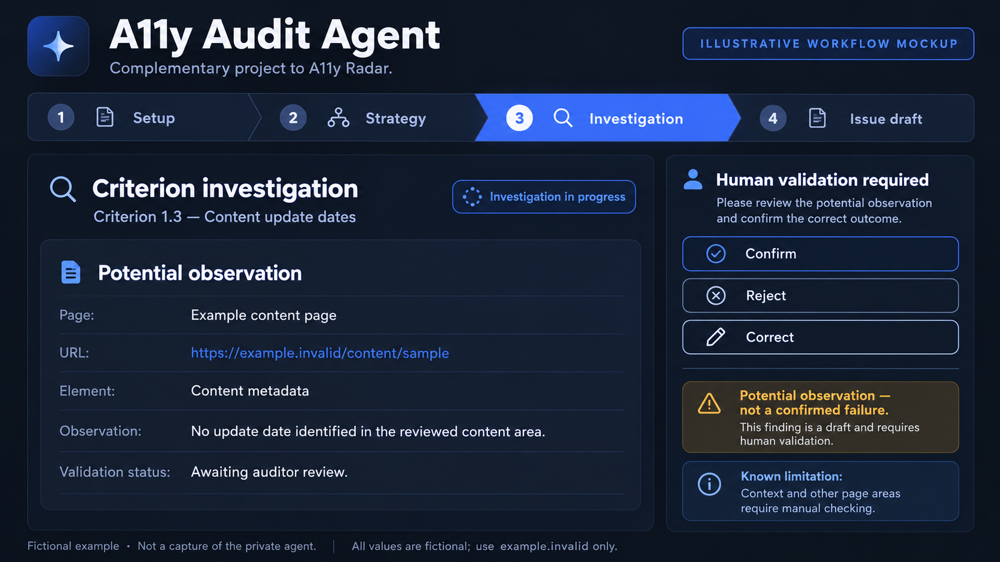
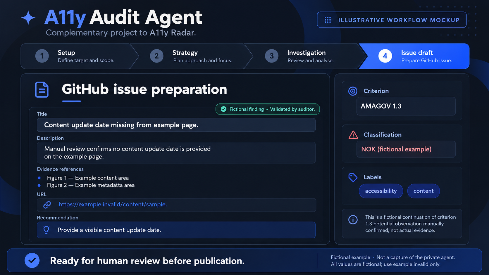

# A11y Audit Agent

**AI-assisted accessibility auditing with mandatory human validation.**

A personal project designed and built by **Thayrine Souza** to bring a structured, adaptable QA workflow to accessibility investigation and issue preparation.

I initially developed and tested the agent independently against public websites. After iterative testing and refinement, it began supporting real accessibility auditing workflows.

> **Project showcase**
>
> This repository documents the project, its design decisions, workflow and outcomes.
> The agent's private implementation, operational instructions and configuration are intentionally not distributed.

---

## The problem

Accessibility auditing involves much more than identifying a potential issue.

An auditor needs to:

- understand the scope and structure of a website;
- determine which pages should be investigated;
- interpret accessibility requirements;
- reproduce and validate behaviours;
- collect evidence;
- document findings consistently;
- communicate issues clearly to the people responsible for remediation.

Moving repeatedly between investigation, notes, validation and issue tracking makes parts of this process repetitive.

AI can help with some of these tasks, but it introduces an important risk: **a plausible AI-generated observation must never automatically become an accessibility finding.**

The challenge was therefore not simply to make AI analyse websites.

The goal was to design a workflow where AI could support the investigation while the auditor remained responsible for the final quality decision.

---

## The solution

**A11y Audit Agent** is an instruction-driven AI agent designed around a structured accessibility auditing workflow.

It supports the auditor through:

1. audit setup;
2. sitemap discovery;
3. scope and strategy definition;
4. criterion-based investigation;
5. structured presentation of potential findings;
6. mandatory human validation;
7. GitHub issue preparation.

The agent does not replace the auditor.

It supports investigation, organization and documentation while keeping interpretation and final validation under human control.

---

## Technology & approach

The project combines AI-assisted investigation with established QA practices.

### Main technologies and concepts

- **OpenAI Codex** — agent execution environment;
- **persistent instruction-driven configuration** — defines behaviour, workflow and reporting rules;
- **sitemap discovery** — supports understanding of website size and structure;
- **accessibility auditing** — based on selected criteria from the AMAGOV accessibility framework;
- **GitHub workflow integration** — supports preparation of structured audit issues;
- **human-in-the-loop validation** — required before a potential finding becomes a final assessment;
- **iterative refinement** — agent behaviour is improved based on differences between AI observations and manual validation.

This project is not a machine-learning model trained from scratch.

Its behaviour is shaped through structured instructions, workflow design, testing, validation and continuous refinement.

---

## How it works

| Stage | Agent support | Auditor responsibility |
| --- | --- | --- |
| **Audit setup** | Organizes the information required to begin. | Defines the website, scope, criteria and investigation boundaries. |
| **Sitemap discovery** | Helps identify website structure and available URLs. | Reviews coverage, relevance and discovery limitations. |
| **Strategy selection** | Presents focused or broader investigation approaches. | Selects the most appropriate strategy. |
| **Criterion investigation** | Organizes potential findings and supporting observations. | Reproduces behaviour and determines whether the observation is relevant. |
| **Human validation** | Incorporates confirmation, rejection or correction into the result. | Makes the final accessibility assessment. |
| **Issue preparation** | Produces a structured GitHub issue draft. | Reviews the content and controls publication. |

---

### 1. Define the audit

The workflow begins by establishing a clear target and scope.

The agent gathers the information required to work within the current audit, such as:

- website URL;
- relevant accessibility criteria;
- investigation scope;
- audit strategy;
- associated GitHub repository when applicable.

This ensures that the investigation starts with explicit boundaries instead of analysing pages without context.

> **Screenshot pending — Audit setup**
>
> A reviewed public demonstration will show the initial audit configuration.

<!-- Future reviewed image:

-->

---

### 2. Understand the website

Before investigating individual criteria, the agent can perform sitemap discovery to better understand the website.

This step can help identify:

- available sitemaps;
- unique URLs;
- different content types;
- language variants;
- potential coverage limitations.

The purpose is not to assume that every discovered URL represents a valid page that must be audited.

Instead, sitemap information supports a more informed investigation strategy.

---

### 3. Choose the investigation strategy

The workflow supports different levels of investigation depending on the objective.

A focused strategy can analyse representative pages across different content types.

A broader strategy can investigate a larger part of the defined scope.

The agent can recommend an approach, but **the auditor makes the decision**.

> **Screenshot pending — Sitemap discovery and strategy selection**
>
> A future reviewed demonstration will show how website structure is assessed before the audit strategy is selected.

<!-- Future reviewed image:

-->

---

### 4. Investigate accessibility criteria

During investigation, the agent organizes potential occurrences with contextual information such as:

- page;
- affected element;
- observation;
- direct URL;
- pages analysed;
- known limitations;
- need for manual validation.

The result is intentionally presented as an **observation requiring review**, not as an automatically confirmed accessibility failure.

> **Screenshot pending — Criterion investigation**
>
> The public demonstration will show a structured observation awaiting human validation.

<!-- Future reviewed image:

-->

---

### 5. Validate the result

Human validation is a mandatory part of the workflow.

The auditor can:

- confirm an observation;
- reject a false positive;
- correct an incomplete interpretation;
- identify something the agent did not detect;
- leave an occurrence unresolved when additional investigation is required.

The final accessibility assessment always remains under human control.

---

### 6. Prepare the GitHub issue

After validation, the agent can prepare a structured issue containing elements such as:

- issue title;
- description;
- evidence structure;
- figure references;
- URLs to verify;
- recommendations;
- accessibility criterion;
- OK or NOK classification;
- repository labels where applicable.

The auditor reviews the final content before publication.

**Issue publication remains intentionally human-controlled.**

> **Screenshot pending — GitHub issue preparation**
>
> The future image will use reviewed demonstration data.

<!-- Future reviewed image:

-->

---

## Designed around the auditor, not the other way around

One of the main design principles of A11y Audit Agent is that the auditor should not have to change an established methodology just to use AI.

The agent can be configured around the auditor's workflow, including:

- investigation structure;
- terminology;
- evidence format;
- reporting conventions;
- level of technical detail;
- classification rules;
- recommendation structure;
- writing style.

For example, the output can be designed to favour:

- concise or detailed explanations;
- technical or simpler language;
- more natural and human-readable writing;
- specific evidence structures;
- consistent issue formatting.

In my own workflow, I configured the agent to follow the structure and writing conventions I use when documenting accessibility findings.

The objective is not to produce generic AI responses.

The objective is to produce output that fits into a repeatable professional QA process.

The private instructions that make this adaptation possible are **not included in this repository**.

---

## Current accessibility scope

The current workflow has been configured to support investigation of eight criteria from the **Content checklist of the Kit Selo de Usabilidade e Acessibilidade da AMA (AMAGOV)**.

| Criterion | Investigation |
| --- | --- |
| **1.3** | Content update dates |
| **1.4** | Identification of the content owner on every page |
| **4.1** | Linked index for long documents/pages |
| **4.2** | Responsive adaptation without horizontal page scrolling |
| **5.1** | Investigation of elements that appear or activate only on hover |
| **5.2** | Minimum interactive target size of 44 × 44 CSS pixels |
| **5.3** | Existence and visual prominence of a single primary action |
| **5.4** | Graphical interactive elements visually identifiable as interactive |

These criteria define the current project scope.

They do not represent complete automated WCAG coverage.

---

## Mandatory human validation

> **An AI observation is provisional until the auditor validates it.**

This is one of the core principles of the project.

Accessibility frequently requires contextual, visual and behavioural interpretation that cannot safely be delegated to an AI system without review.

The auditor therefore remains responsible for:

- interpreting the requirement;
- reproducing the behaviour;
- checking the evidence;
- confirming or rejecting the observation;
- assigning the final classification.

A generated response alone is **not evidence of conformance or non-conformance**.

---

## Continuous improvement through validation

The agent has been refined through iterative testing.

Real investigation scenarios have exposed situations where the agent's interpretation differed from manual validation.

These cases are useful rather than hidden.

False positives and incorrect interpretations are analysed to understand why the agent reached the wrong conclusion and whether the workflow or instructions should be improved.

This creates a feedback loop:

```text
AI investigation
        ↓
Potential finding
        ↓
Human validation
        ↓
Confirmed / Rejected / Corrected
        ↓
Analysis of disagreement
        ↓
Instruction and workflow refinement
        ↓
Next investigation
```

An unresolved observation remains pending until further investigation. Refinement is a deliberate review activity; it does not imply automatic learning or retraining of the underlying model.

---

## Results and lessons learned

The project progressed from independent testing on public websites to supporting real accessibility auditing workflows. Its practical outputs include structured observations, documentation aligned with my reporting conventions and GitHub issue drafts that remain subject to human review.

The main lessons from development and refinement are:

- **Context matters.** Defining scope and criteria gives the investigation clear boundaries.
- **Disagreement is useful feedback.** Differences between AI observations and manual validation help identify where the workflow needs refinement.
- **Consistent reporting supports review.** Evidence and recommendations are easier to assess when they follow an established structure.
- **Human judgement remains essential.** The auditor must be able to reject, correct or supplement the agent's output.

These are qualitative outcomes reported from my own use of the project. This showcase does not publish verified accuracy rates, time savings or coverage benchmarks. Public demonstration screenshots are still pending.

---

## Limitations

- AI observations can be incorrect, incomplete or misleading.
- Sitemap discovery may miss pages, interaction states or dynamically available content.
- Representative page selection limits conclusions about pages outside the reviewed sample.
- A broader investigation does not guarantee exhaustive testing.
- Visual, contextual and behavioural requirements may need manual checks and assistive-technology testing.
- Support for the selected checklist criteria does not establish complete WCAG conformance.
- Issue preparation does not verify remediation or replace a final reporting review.
- The private implementation cannot be independently executed from this repository.

This project does not provide accessibility certification or an automatic conformance decision.

---

## Public demonstration

Four reviewed screenshots will illustrate the workflow: audit setup, sitemap discovery and strategy selection, criterion investigation, and issue preparation after validation.

The demonstration will use a public site unrelated to client or workplace activity. Captures will be reviewed to exclude private information and internal agent instructions. They will show authentic outputs without fabricating findings.

See the [screenshot guide](docs/SCREENSHOT-GUIDE.md) for the planned filenames and review process.

---

## Repository contents

| File or folder | Purpose |
| --- | --- |
| [README.md](README.md) | Project case study. |
| [docs/SCREENSHOT-GUIDE.md](docs/SCREENSHOT-GUIDE.md) | Screenshot plan and publication review guidance. |
| [assets/screenshots/](assets/screenshots/README.md) | Reserved location for reviewed demonstration images. |

This is a documentation-only showcase. There are no installation steps, agent scripts or live GitHub integration in this repository.

---

## Private implementation and confidentiality

The real agent, source code, prompts, internal instructions, agent instruction files and executable configuration remain private. Credentials, client data, workplace URLs and private repository details are excluded.

The technology and workflow descriptions provide portfolio context. They do not disclose the operational instructions, settings or implementation needed to reproduce the agent.

---

## Reference

The criterion numbers and brief descriptions above refer specifically to the [official Content checklist in the AMA usability and accessibility seal kit](https://selo.usabilidade.gov.pt/requisitos/conteudo/). They are summaries of the project's investigation scope, not the complete checklist requirements or WCAG success criterion identifiers.

---

**Designed and built by Thayrine Souza.**
